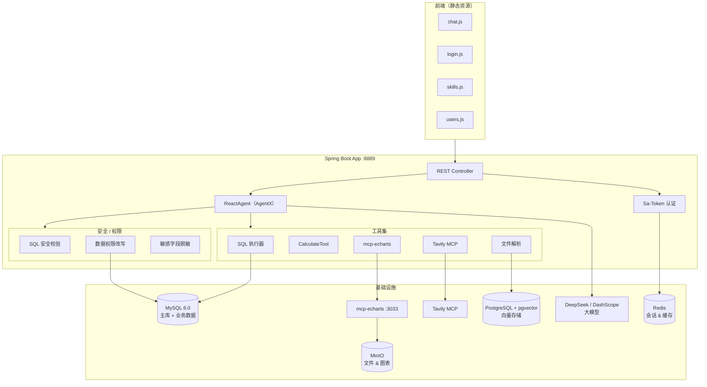

# 🤖 Checkdata Agent

[](https://spring.io/projects/spring-boot)
[](https://openjdk.org/)
[](https://spring.io/projects/spring-ai)
[](LICENSE)

> 一个基于 **Spring AI AgentX** 的数据分析智能体。用自然语言问数据库，Agent 自动理解意图、查结构、写 SQL、过安全、执行查询，最终输出带图表的分析报告。

---

## ✨ 核心特性

### 📊 Data-Agent 数据分析（主打）

自然语言 → SQL 的完整智能流水线：

```
用户提问 → Schema 自省 → 生成 SQL → 安全校验 → 执行查询 → 权限过滤 → 脱敏 → 报告生成
```

- 🧠 **自然语言查询** — "上个月各部门销售额排名" → 自动转 SQL
- 🔍 **Schema 实时自省** — 启动时自动扫描表结构、字段、外键，无需手动维护字典
- 🛡️ **多层安全防护**
  - 只读拦截：DROP / DELETE / UPDATE / ALTER 一律拒绝
  - 强制 LIMIT：避免全表扫爆
  - EXPLAIN 预检查：拦截预估行数过大的查询
- 🔐 **数据权限** — 按角色/部门自动改写 SQL（ALL / DEPT_AND_SUB / DEPT / SELF）
- 🎭 **敏感字段脱敏** — 密码、身份证号、地址等自动替换为 `********`
- 📐 **复杂计算** — 环比、占比、贡献度、同比等指标由 CalculateTool 完成
- 📈 **图表生成** — 通过 mcp-echarts 生成 ECharts 图表，上传 MinIO 返回图片 URL

### 👤 用户体系

- Sa-Token 登录认证
- 用户 / 角色 / 部门管理
- 四种数据权限粒度：`ALL` · `DEPT_AND_SUB` · `DEPT` · `SELF`

### 🧩 Skills 机制

- 本地 `skills/` 目录与数据库同步
- 支持上传、启停、删除
- 预置 Skill：`data-analysis` / `skill-creator` / `域名创意生成器`

### 📎 文件问答

- PDF / Office / Markdown / HTML / 纯文本 / 图片 全覆盖
- 小文件直接解析，大文件自动切分 + PGVector 向量检索
- 支持多模态图片理解

### 🌐 联网搜索（可选）

- Tavily MCP 接入
- 前端一键开关，关闭即不注入搜索工具

---

## 🏗️ 架构一览



---

## 🧱 技术栈

| 分类 | 技术 | 版本 |
|------|------|------|
| 语言 | Java | 21 |
| 框架 | Spring Boot | 3.5.6 |
| AI | Spring AI | 1.1.0 |
| AI | Spring AI Alibaba | 1.1.2.0 |
| 智能体 | Spring AI AgentX | 1.0.1-M1 |
| 持久层 | MyBatis-Plus | 3.5.12 |
| 数据库 | MySQL | 8.0+ |
| 向量库 | PostgreSQL + pgvector | - |
| 缓存 | Redis | - |
| 对象存储 | MinIO | - |
| 认证 | Sa-Token | 1.39.0 |
| SQL 解析 | JSqlParser | 5.1 |
| 文件解析 | Apache Tika | 2.9.2 |
| 构建 | Maven | 3.9+ |

---

## 🗂️ 项目结构

```
checkdata-agent/
├── src/main/java/com/checkdata/agent/
│   ├── CheckdataAgentApplication.java   ← 启动类
│   ├── auth/          # 登录认证
│   ├── common/        # 通用异常、响应封装
│   ├── config/        # 配置类（MCP、数据源等）
│   ├── controller/    # REST API
│   ├── mapper/        # MyBatis Mapper
│   ├── domain/        # 业务实体 / DTO
│   ├── service/       # 业务服务层
│   ├── sys/           # 用户/角色/权限模块
│   ├── skill/         # Skills 管理
│   ├── tools/         # Agent 工具（SQL、计算、图表...）
│   ├── prompt/        # System Prompt 模板
│   ├── splitter/      # 大文件切分策略
│   └── utils/         # 工具类
├── src/main/resources/
│   ├── application.yml                  # 本地运行配置（已 gitignore）
│   ├── application-example.yml          # 配置模板（GitHub 保留）
│   └── static/                          # 前端页面
│       ├── index.html                   # 聊天主页
│       ├── login.html                   # 登录
│       ├── skills.html                  # Skills 管理
│       ├── users.html                   # 用户管理
│       └── js/                          # 前端脚本
├── sql/
│   └── init.sql                         # 数据库初始化脚本
└── pom.xml
```

---

## 📦 数据库一览

init.sql 预置了 30 张表，开箱即用：

### AgentX 框架表（8 张）

| 表名 | 用途 |
|------|------|
| `agentx_conversation` | 会话窗口 |
| `agentx_session` | 消息链表（新版结构：state_key / state_data） |
| `agentx_trace` | 工具调用轨迹 |
| `agentx_memory` | 长期语义记忆 |
| `agentx_skill` | Skills 注册 |
| `agentx_file` | 文件上传记录 |
| `agentx_pause_state` | Pause 暂停状态存储 |

### Sakila 影视租赁业务表（16 张，含数据）

| 表名 | 说明 | 数据量 |
|------|------|--------|
| `actor` | 演员 | 200 |
| `film` | 电影 | 1,000 |
| `film_actor` | 电影-演员关联 | 5,462 |
| `film_category` | 电影-分类关联 | 1,000 |
| `film_text` | 电影全文 | 1,000 |
| `category` | 分类 | 16 |
| `language` | 语言 | 6 |
| `country` / `city` / `address` | 地理三级 | 109+600+603 |
| `customer` | 客户 | 599 |
| `inventory` | 库存 | 4,581 |
| `rental` | 租赁 | 16,044 |
| `payment` | 支付 | 16,044 |

### 电商业务表（4 张）

| 表名 | 说明 |
|------|------|
| `orders` | 订单主表 |
| `order_detail` | 订单明细 |

### 用户权限表（6 张）

| 表名 | 说明 |
|------|------|
| `sys_user` / `sys_role` / `sys_dept` | 用户、角色、部门 |
| `sys_user_role` / `sys_user_dept` | 关联表 |
| `user_profile` | 用户档案 |

---

## 🚀 快速启动

### ✅ 前置条件

```
✅ JDK 21       ✅ Maven 3.9+     ✅ MySQL 8.0+
✅ PostgreSQL   ✅ pgvector       ✅ Redis
✅ MinIO        ✅ Node.js 18+    ✅ (可选) Tavily API Key
```

### Step 1 — 初始化数据库

```bash
# 创建数据库
mysql -u root -p -e "CREATE DATABASE checkdata_agent DEFAULT CHARACTER SET utf8mb4 COLLATE utf8mb4_general_ci;"

# 导入表结构 + 预置数据
mysql -u root -p checkdata_agent --default-character-set=utf8mb4 < sql/init.sql
```

> ⚠️ 如果之前手动改过 `agentx_session` 导致表结构不对（缺 `state_data` 等列），直接 DROP 后重新导入即可。

### Step 2 — 准备配置文件

```bash
cp src/main/resources/application-example.yml src/main/resources/application.yml
```

然后编辑 `application.yml`，替换以下占位符：

| 配置 | 说明 | 必填 |
|------|------|:----:|
| `spring.datasource.password` | MySQL 密码 | ✅ |
| `spring.data.redis.*` | Redis 连接 | ✅ |
| `spring.ai.deepseek.api-key` | DeepSeek 主模型 Key | ✅ |
| `spring.ai.openai.api-key` | DashScope Key（多模态 + Embedding） | ✅ |
| `embeddings.store.*` | PgVector 连接 | ✅ |
| `minio.*` | MinIO 连接 | ✅ |
| `skills.directory` | 本地 skills 目录绝对路径 | ✅ |
| `tavily.api-key` | Tavily 联网搜索 | ❌ |
| `data-agent.chart.mcp-url` | mcp-echarts 地址 | 默认 `localhost:3033` |

### Step 3 — 启动基础服务

**MinIO**
```bash
docker run -d -p 9000:9000 -p 9001:9001 \
  -e MINIO_ROOT_USER=root -e MINIO_ROOT_PASSWORD=12345678 \
  minio/minio server /data --console-address ":9001"
```

**Redis**（没装的话，Docker 一键起）
```bash
docker run -d -p 6379:6379 redis:7-alpine
```

**mcp-echarts**（图表功能需要，可选）
```bash
npm install -g @mcp-echarts/server

# Windows PowerShell
$env:MINIO_ENDPOINT="127.0.0.1"
$env:MINIO_PORT="9000"
$env:MINIO_ACCESS_KEY="root"
$env:MINIO_SECRET_KEY="12345678"
$env:MINIO_BUCKET_NAME="checkdata-agent-files"
mcp-echarts -t streamable
```

> 💡 不想用图表？注释掉 `application.yml` 中 `data-agent.chart` 段即可，不影响核心数据查询功能。

### Step 4 — 编译并启动

```bash
# 先编译（首次必须 install，AgentX 核心包要进本地仓库）
mvn clean install -DskipTests

# 然后启动
mvn spring-boot:run
```

或在 IDE 中直接运行启动类：
```text
com.checkdata.agent.CheckdataAgentApplication
```

启动成功后访问：**http://localhost:8889/**

---

## 🔑 默认账号

| 账号 | 密码 | 角色 | 数据范围 |
|------|------|------|----------|
| `admin` | `123456` | 管理员 | ALL（全量可见） |
| `mgr_test` | `123456` | 部门经理 | DEPT_AND_SUB |
| `analyst_test` | `123456` | 分析师 | DEPT |
| `sh_sales` | `123456` | 上海销售 | SELF |
| `hz_sales` | `123456` | 杭州销售 | SELF |

> 💡 **数据权限演示**：用 `admin` 和 `sh_sales` 分别问"客户列表"，会看到 SQL 被自动改写，返回的数据范围不同。

---

## 🧪 快速验证

登录后试试这些问题：

```
1. 你有哪些技能？
2. 2005 年租赁次数最多的 Top 10 客户（姓名、次数、总金额）
3. 各电影分类的库存分布，按库存倒序
4. 动作片 vs 喜剧片，哪个平均片长更长？
5. 各部门订单总金额排名
```

---

## ❓ 常见问题

<details>
<summary><b>编译后依赖找不到 / 类找不到</b></summary>

请确认在项目根目录执行过完整编译：
```bash
mvn clean install -DskipTests
```
这会把所有依赖安装到本地 Maven 仓库。AgentX 的核心包需要从本地模块解析，不能只 `compile`。
</details>

<details>
<summary><b>agentx_session 报 Unknown column 'state_data'</b></summary>

说明你的表结构还是旧版。修复方法：
```sql
DROP TABLE IF EXISTS agentx_session;
-- 然后执行 sql/init.sql 里 agentx_session 的 CREATE TABLE 语句
```
新版结构字段：`conversation_id` / `session_id` / `state_key` / `item_index` / `state_data` / `created_at` / `updated_at`。
</details>

<details>
<summary><b>图表生成失败 / mcp-echarts 未就绪</b></summary>

检查清单：
- [ ] `mcp-echarts` 进程是否已启动？
- [ ] `data-agent.chart.mcp-url` 是否匹配（默认 `http://localhost:3033/mcp`）
- [ ] mcp-echarts 的 MinIO 环境变量是否和 `application.yml` 一致
- [ ] 是否用了 `-t streamable` 启动（避免 base64 撑爆上下文）

不打算用图表？直接注释掉 `application.yml` 中 `data-agent.chart` 段即可。
</details>

<details>
<summary><b>不想启用联网搜索</b></summary>

不填 Tavily API Key 即可。启动时会看到 `WARN Tavily MCP client 未就绪，联网工具不注入`，这是**正常的**。前端联网开关关闭后 Agent 不会调用搜索。
</details>

<details>
<summary><b>Redis / MinIO / PostgreSQL 没装怎么办？</b></summary>

全部可以用 Docker 一键起：
```bash
# Redis
docker run -d -p 6379:6379 redis:7-alpine

# MinIO
docker run -d -p 9000:9000 -p 9001:9001 \
  -e MINIO_ROOT_USER=root -e MINIO_ROOT_PASSWORD=12345678 \
  minio/minio server /data --console-address ":9001"

# PostgreSQL + pgvector
docker run -d -p 5432:5432 -e POSTGRES_PASSWORD=postgres pgvector/pgvector:pg16
```
</details>

<details>
<summary><b>idea 的 Terminal 用啥 shell？</b></summary>

项目里的 mcp-echarts 启动示例给了 PowerShell 和 cmd 两套命令。推荐用 **Git Bash** 或 **PowerShell 7**，原生 bash/cmd 的编码处理会坑人（之前 chat.js 乱码就是这个原因）。
</details>

---

## 📄 License

MIT License — 仅供学习和研究使用。